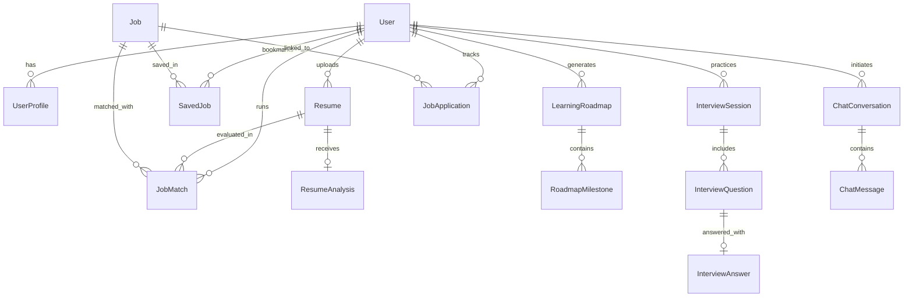

# CareerPilot AI — Intelligent Resume Analyzer & Career Recommendation Platform

> A production-minded full-stack AI career intelligence platform featuring transparent 100-point ATS resume scoring, deterministic job description matching, personalized 6-week learning sprint roadmaps, STAR behavioral mock interviews, and an application pipeline tracker — powered by the official Anthropic Claude API.

---

## 1. System Architecture & Tech Stack

```
                          ┌─────────────────────────────────────┐
                          │    CareerPilot AI React Frontend    │
                          │   (React 18 + TS + Tailwind + Vite) │
                          └──────────────────┬──────────────────┘
                                             │ HTTP REST / JSON
                                             ▼
                          ┌─────────────────────────────────────┐
                          │     FastAPI Python 3.12+ Backend    │
                          │   (Async REST, JWT Auth, Pydantic)  │
                          └──────┬───────────────────────┬──────┘
                                 │                       │
               ┌─────────────────┴─────────┐   ┌─────────┴───────────────┐
               ▼                           ▼   ▼                         ▼
    ┌──────────────────────┐    ┌────────────────────┐    ┌─────────────────────┐
    │    SQLite / Postgres │    │  Official Anthropic│    │   PyMuPDF & Docx    │
    │  Normalized Database │    │     Claude API     │    │ Document Extraction │
    └──────────────────────┘    └────────────────────┘    └─────────────────────┘
```

- **Frontend:** React 18, TypeScript, Tailwind CSS, Vite, Lucide Icons, Recharts
- **Backend:** Python 3.12+, FastAPI, Pydantic v2, SQLAlchemy, Bcrypt, PyJWT
- **Database:** PostgreSQL (with out-of-the-box local SQLite fallback `careerpilot.db`)
- **AI Engine:** Official Anthropic Claude SDK (`ANTHROPIC_MODEL` environment-configured)
- **Document Processing:** PyMuPDF (`fitz`), `python-docx`

---

## 2. Database Entity-Relationship Diagram



---

## 3. Key Implemented Features

1. **Explainable 100-Point ATS Resume Audit:**
   - 5-factor rubric: Structure & Readability (20 pts), Skills & Technical Relevance (25 pts), Projects Evidence (25 pts), Clarity & Impact (20 pts), Completeness (10 pts).
   - Google XYZ Formula bullet point rewrites (*"Accomplished [X], measured by [Y], by doing [Z]"*).
   - Categorized skills extraction (Languages, Frameworks, Databases, Tools, Methodologies).

2. **Deterministic Job Description Matcher:**
   - 100-point compatibility score broken down into Skills (40%), Experience (30%), Education (15%), and Explicit Requirements (15%).
   - Line-by-line evidence auditing against resume text.
   - Truthful recommendation engine for closing gaps without fabricating false experience.

3. **Curated Recommended Opportunities:**
   - Searchable, filterable vacancies (Remote, Hybrid, Onsite, Experience level).
   - 1-click resume match comparison and bookmarking.

4. **Personalized 6-Week Sprint Roadmaps:**
   - Systematic curriculum addressing missing technical competencies.
   - Interactive milestone checkboxes persisted to the database.
   - Weekly tasks, capstone portfolio projects, and curated documentation links.

5. **AI Resume Builder & Role Tailoring:**
   - Generates tailored executive summaries and prominent skill positioning.
   - Generates 3-paragraph tailored cover letters with 1-click clipboard copy.

6. **Interactive AI Mock Interview Simulator:**
   - Scenario questions across Technical, System Design, and Behavioral tracks.
   - Written response submission with instant STAR framework (Situation, Task, Action, Result) evaluation.
   - Final comprehensive interview performance report.

7. **Job Application Pipeline Tracker:**
   - Tracks applications across 8 statuses: `Interested`, `Saved`, `Applied`, `Assessment`, `Interview`, `Offer`, `Rejected`, `Withdrawn`.
   - Notes, interview dates, and offer details.

8. **Context-Grounded Career Assistant Chatbot:**
   - Conversational AI strategist grounded in the candidate's resume, target role, and roadmaps.

---

## 4. Quickstart Guide (Local Development)

### Prerequisites
- Python 3.10+
- Node.js 18+ & npm

### Step 1: Start the Backend

```bash
cd backend
python3 -m pip install -r requirements.txt
python3 -m uvicorn app.main:app --host 127.0.0.1 --port 8000 --reload
```
*The database automatically creates and seeds sample vacancies and a demo user on first run.*
- API Docs: `http://127.0.0.1:8000/api/v1/docs`
- Health Check: `http://127.0.0.1:8000/health`

### Step 2: Start the Frontend

```bash
cd frontend
npm install
npm run dev
```
Open **[http://localhost:5173](http://localhost:5173)** in your browser.

---

## 5. Pre-Seeded Candidate Credentials

You can test the platform using the pre-seeded account:
- **Email:** `demo@careerpilot.ai`
- **Password:** `CareerPilot2026!`

---

## 6. Docker Compose Deployment

To run PostgreSQL, FastAPI, and the React frontend in containers:

```bash
# 1. Configure environment
cp .env.example .env

# 2. Launch all services
docker compose up --build -d
```
Access the application at `http://localhost:5173`.

---

## 7. Running Backend Automated Tests

```bash
cd backend
python3 -m pytest tests/test_api.py -v
```

---

## 8. API Endpoint Reference

| Method | Endpoint | Description |
|---|---|---|
| `POST` | `/api/v1/auth/register` | Register new candidate account |
| `POST` | `/api/v1/auth/login` | Authenticate and obtain JWT token |
| `GET` | `/api/v1/auth/me` | Retrieve profile of authenticated user |
| `PATCH`| `/api/v1/auth/me/profile` | Update skills, preferred role, and preferences |
| `GET` | `/api/v1/dashboard/stats` | Aggregate readiness metrics and stats |
| `POST` | `/api/v1/resumes/upload` | Upload and parse PDF/DOCX resume |
| `GET` | `/api/v1/resumes/` | List candidate resumes |
| `GET` | `/api/v1/resumes/{id}/analysis` | Get 100-point ATS audit report |
| `POST` | `/api/v1/job-matches/analyze` | Run compatibility match against JD |
| `GET` | `/api/v1/jobs/` | Search & filter recommended vacancies |
| `POST` | `/api/v1/roadmaps/generate` | Generate 6-week custom learning sprint |
| `PATCH`| `/api/v1/roadmaps/{id}/milestones/{m_id}` | Toggle milestone completion status |
| `POST` | `/api/v1/interviews/start` | Start interactive mock interview |
| `POST` | `/api/v1/interviews/{id}/answer` | Submit answer for STAR evaluation |
| `POST` | `/api/v1/resume-builder/tailor` | Generate role-specific resume bullets & cover letter |
| `GET` | `/api/v1/applications/` | List tracked job applications |
| `POST` | `/api/v1/chat/` | Send message to Career Strategy Assistant |
